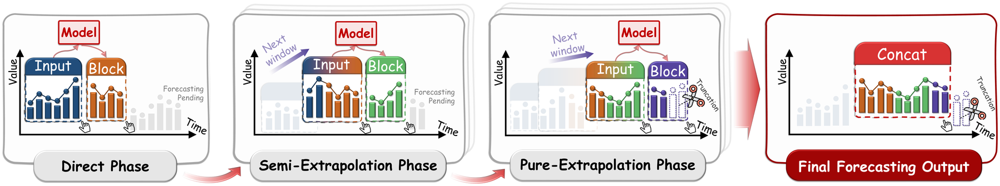
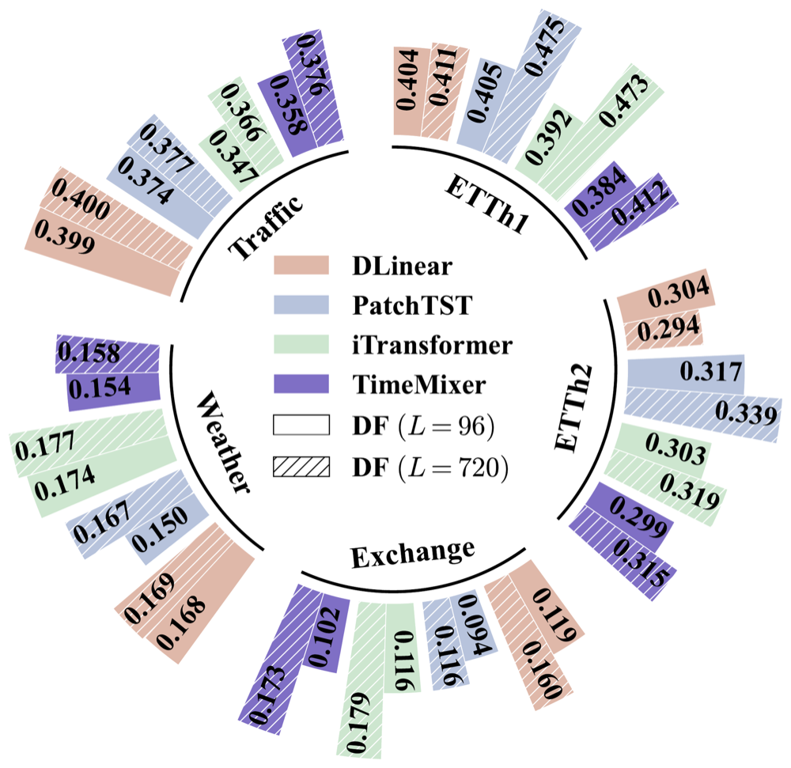
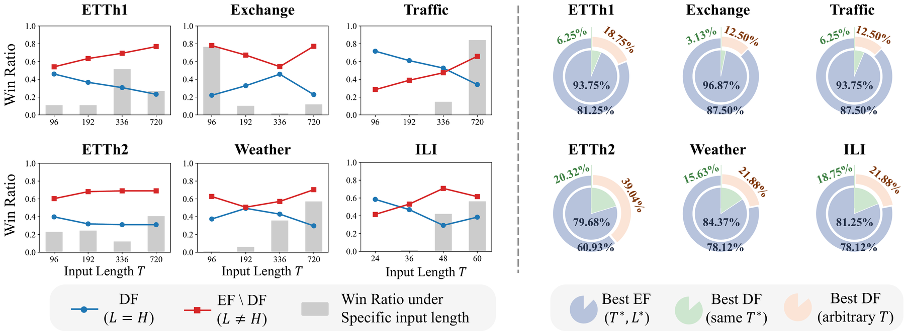
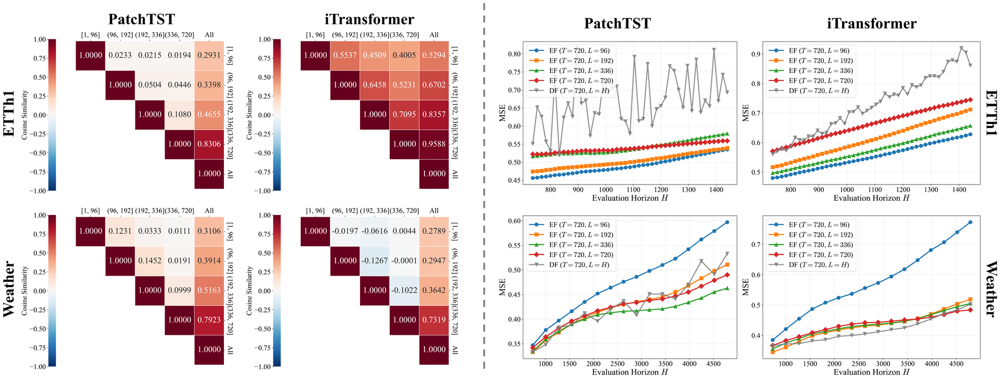

<div align="center">

# To See Far, Look Close: Evolutionary Forecasting for Long-term Time Series

[](https://neurips.cc/Conferences/2026)
[](https://arxiv.org/abs/2601.23114)
[](LICENSE)
[](https://www.python.org/)
[](https://pytorch.org/)
[](https://github.com/thuml/Time-Series-Library)
[](https://github.com/decisionintelligence/TFB)
[](https://github.com/D2I-Group/TSFLab)

[Paper](https://arxiv.org/abs/2601.23114) ·
[Quick Start](#-quick-start) ·
[Time-Series-Library](#-use-with-time-series-library) ·
[TFB](#-use-with-tfb) ·
[TSFLab](#-use-with-tsflab) ·
[Results](#-results) ·
[Citation](#-citation)

</div>

> **TL;DR** Train a forecaster on a short block of `L` steps and roll it forward block by block. A single such model matches or beats horizon-specific Direct Forecasting models across standard benchmarks and stays stable at very long horizons.

<p align="center">
  
</p>

## 📰 News

- **2026-11** Camera-ready version and the EF adapters for Time-Series-Library, TFB and TSFLab (formerly ModernTSF) are released.
- **2026-09** EF is accepted to **NeurIPS 2026** as a poster.
- **2026-02** The preprint is available on [arXiv](https://arxiv.org/abs/2601.23114).

## 📑 Contents

- [Why Evolutionary Forecasting?](#-why-evolutionary-forecasting)
- [How it works](#-how-it-works)
- [Installation](#-installation)
- [Quick start](#-quick-start)
- [Use with Time-Series-Library](#-use-with-time-series-library)
- [Use with TFB](#-use-with-tfb)
- [Use with TSFLab](#-use-with-tsflab)
- [Results](#-results)
- [Choosing the block length L](#-choosing-the-block-length-l)
- [Repository structure](#-repository-structure)
- [Citation](#-citation)

## 💡 Why Evolutionary Forecasting?

Long-term forecasting benchmarks evaluate several horizons `H ∈ {96, 192, 336, 720}`. The common protocol, **Direct Forecasting (DF)**, ties the model's output length `L` to the evaluation horizon (`L = H`). This means one model has to be retrained for every horizon.

Larger `L` is not better. Truncating a 720-step model to its first 96 steps is usually *worse* than a model trained for 96 steps:

<p align="center">
  
  <br><em>MSE at H = 96 with T = 720: models trained with L = 96 (solid) vs. truncated L = 720 models (hatched).</em>
</p>

**EF** treats `L` as an ordinary hyperparameter rather than a property of the task:

- 🧩 **Model-agnostic.** EF wraps any existing DF model without changing its architecture or loss.
- 🔁 **One model for all horizons.** You train once with a short block and reuse that model for every `H`.
- 📈 **More accurate.** EF reduces MSE by up to 13.92% relative to DF on the paper's main table.
- 🧭 **Stable far out.** Degradation stays smooth when `H` grows far beyond the benchmark range.
- 🔬 **Explained by optimization.** With `L = H`, gradients from distant steps conflict with near-term ones and dominate the update. This leaves the near future under-fitted.

## ⚙️ How it works

Given a model `F` with input length `T` and output length `L`, EF produces a horizon-`H` forecast with `K = ⌈H / L⌉` calls:

```
Ŷ = [ B(1) | B(2) | … | B(K) ][: H],      B(k) = F( X̃(k) )
```

The input window `X̃(k)` of block `k` always has length `T` and moves through three phases:

| Phase | Condition | Input window |
|---|---|---|
| Direct | `k = 1` | the observed history `X` |
| Semi-extrapolation | `0 < (k-1)L < T` | the tail of `X` followed by the blocks generated so far |
| Pure extrapolation | `(k-1)L ≥ T` | only generated blocks |

DF is the special case `L ≥ H` (`K = 1`). Training is unchanged: EF optimizes only the first block, which is standard supervised training at horizon `L`.

## 📦 Installation

```bash
pip install git+https://github.com/PoorOtterBob/EvolutionaryForecasting.git
```

Or, for development:

```bash
git clone https://github.com/PoorOtterBob/EvolutionaryForecasting.git
cd EvolutionaryForecasting
pip install -e ".[test]"
pytest tests
```

The only dependency is PyTorch.

## 🚀 Quick start

Any model that maps `[B, T, C] → [B, L, C]` works:

```python
from ef import evolutionary_forecast

model = MyForecaster(seq_len=96, pred_len=24)   # trained as usual with L = 24
y_hat = evolutionary_forecast(model, x, horizon=720)   # x: [B, 96, C] -> y_hat: [B, 720, C]
```

`block_len` defaults to `model.pred_len`. You can also pass it explicitly: `evolutionary_forecast(model, x, horizon=720, block_len=24)`. For full control over each call, use `ef.rollout(block_fn, x, horizon, block_len)`, where `block_fn(window, k)` returns block `k`.

`examples/quickstart.py` trains a linear model with `L = 24` on a toy series and compares it with a `L = H = 192` model. It runs in about a second on a CPU.

## 🧪 Use with Time-Series-Library

[Time-Series-Library](https://github.com/thuml/Time-Series-Library) (TSLib) models use the signature `model(x_enc, x_mark_enc, x_dec, x_mark_dec)`. `ef.EvolutionaryForecaster` wraps a model trained with `pred_len = L` and keeps that signature, so TSLib's own `test()` loop evaluates it at any horizon. The horizon is read from the length of the decoder input.

**1. Install the adapter into TSLib** (tested on TSLib commit `4e938a1`):

```bash
pip install git+https://github.com/PoorOtterBob/EvolutionaryForecasting.git
cd Time-Series-Library
cp /path/to/EvolutionaryForecasting/integrations/tslib/exp_ef_forecasting.py exp/
git apply /path/to/EvolutionaryForecasting/integrations/tslib/run_py.patch
```

The patch adds one argument, `--ef_eval_horizons`. When it is set, `run.py` uses `Exp_EF_Forecast`. Training is TSLib's standard long-term forecasting at `--pred_len L`. Testing evaluates the same model at every requested `H`.

**2. Train once, evaluate at all horizons:**

```bash
python -u run.py \
  --task_name long_term_forecast --is_training 1 \
  --root_path ./dataset/ETT-small/ --data_path ETTh1.csv --data ETTh1 \
  --model_id ETTh1_720_96 --model PatchTST --features M \
  --seq_len 720 --label_len 48 --pred_len 96 \
  --ef_eval_horizons 96 192 336 720 \
  --enc_in 7 --dec_in 7 --c_out 7 --e_layers 1 --n_heads 2 --des EF --itr 1
```

Results for each horizon are appended to `result_long_term_forecast.txt` under `<setting>_H<horizon>`.

**Notes**

- Decoder start tokens (`label_len`) for each block are taken from the end of that block's input window. Only observed history and generated values are used.
- Time-feature marks come from the data loader. If the last block extends past `H`, the final mark is repeated.
- `tests/test_ef.py` checks the wrapper value for value against the rollout used for the paper's experiments. The check covers models that do not read the decoder input, such as DLinear, PatchTST and iTransformer. The paper code filled the decoder start tokens of later blocks from the target tensor; the wrapper fills them from the input window instead.

To use the wrapper directly in your own loop:

```python
from ef import EvolutionaryForecaster

ef_model = EvolutionaryForecaster(tslib_model, block_len=96, label_len=48)
y_hat = ef_model(batch_x, batch_x_mark, dec_inp, batch_y_mark)   # dec_inp: [B, label_len + H, C]
```

## 📊 Use with TFB

[TFB](https://github.com/decisionintelligence/TFB) already rolls a deep model forward block by block whenever the evaluation horizon exceeds the model's own horizon. See `DeepForecastingModelBase.batch_forecast` in TFB. EF on TFB therefore needs **no code change**: set the model horizon to `L` and the strategy horizon to `H`.

```bash
cd TFB
bash /path/to/EvolutionaryForecasting/integrations/tfb/run_ef_tfb.sh
# or, e.g.
DATA=Weather.csv MODEL=iTransformer SEQ_LEN=720 L=192 bash /path/to/.../run_ef_tfb.sh
```

The key difference from a standard TFB script is the pair of horizons:

```bash
--strategy-args '{"horizon": 720}'                          # evaluation horizon H
--model-hyper-params '{"horizon": 96, "seq_len": 720, ...}'  # block length L
```

## 🧰 Use with TSFLab

[TSFLab](https://github.com/D2I-Group/TSFLab) (formerly ModernTSF) discovers catalog models from `src/tsflab/models/<package>/spec.py`. EF ships as one such package. It defines a catalog model named **`EF`** that wraps any other catalog model: the base model is built with `pred_len = block_len` and rolled out to the run's `task.pred_len`.

**1. Install the package into TSFLab:**

```bash
cd TSFLab
uv pip install git+https://github.com/PoorOtterBob/EvolutionaryForecasting.git
cp -r /path/to/EvolutionaryForecasting/integrations/tsflab/evolutionary_forecasting src/tsflab/models/
cp /path/to/EvolutionaryForecasting/integrations/tsflab/ef_etth1.toml configs/runs/
uv run tsf catalog show EF --params
```

**2a. One command per horizon.** `EF` trains only the first block, which is standard training at horizon `block_len`. It then evaluates the full rollout:

```toml
[model]
name = "EF"

[model.params]
base = "PatchTST"      # any catalog model
block_len = 96         # L
[model.params.base_params]
enc_in = 7             # base-model parameters; set channel widths explicitly

[sweep]
task.pred_len = [96, 192, 336, 720]   # H
```

```bash
uv run tsf run configs/runs/ef_etth1.toml
```

**2b. Paper protocol: one model for all horizons.** Train the base model once in an ordinary TSFLab run with `task.pred_len = L`. Then evaluate its checkpoint at every `H` with `EF`. The wrapper loads the base model's checkpoint directly:

```toml
[task]
pred_len = 720   # H

[evaluation]
checkpoint_path = "work_dirs/_runs/PatchTST-<run-id>/checkpoints/best_checkpoint.pth"   # from the pred_len = L run
```

With the same checkpoint and `pred_len = block_len`, `EF` reproduces the base model's metrics exactly.

Because every run goes through TSFLab's own data splits, metrics and run records, EF results sit next to all other catalog models on the same leaderboard.

## 📈 Results

EF is evaluated with eight DF backbones: DLinear, PatchTST, iTransformer, TimeMixer, SparseTSF, TimeBase, TimeBridge and TimeEmb. The datasets are ETTh1, ETTh2, Exchange, Weather, Traffic and ILI, over all `(T, L, H)` combinations.

<p align="center">
  
  <br><em><b>Left:</b> win ratio of non-DF configurations (L ≠ H) against DF (L = H) for each input length T. <b>Right:</b> one fixed EF configuration (T*, L*) against horizon-specific DF models.</em>
</p>

- **The DF diagonal is rarely optimal.** `L = H` gives the best result in only 23.20% of cases on ETTh1 and 30.0% on Weather.
- **One-for-all.** A single EF model with fixed `(T*, L*)` beats DF models with the same input length in 79.68%–96.87% of comparisons.
- **Extreme horizons.** On ETTh1, every EF configuration outperforms horizon-specific DF as `H` grows beyond the benchmark range, and the gap keeps widening (right panel below).

<p align="center">
  
  <br><em><b>Left:</b> cosine similarity between gradients of forecast segments in DF (T = L = 720); distant segments dominate the total gradient. <b>Right:</b> MSE as the evaluation horizon grows far beyond the benchmark range.</em>
</p>

**Cost.** EF needs `⌈H/L⌉` sequential calls. On ETTh1 with `T = H = 720`, EF with `L = 96` is 8×–11× slower than one-pass DF for PatchTST and iTransformer. That is 13–29 ms per batch, and MSE drops from 0.521 to 0.455 and from 0.553 to 0.476, respectively.

## 🧭 Choosing the block length L

Pick `(T, L)` once, by cumulative validation performance over all target horizons, and reuse it for every `H`. In our experiments:

1. `L` shorter than `H` usually works best.
2. Very small blocks can destabilize some backbones. For example, iTransformer collapses at `L = 1`.
3. `L` should cover the dominant period of the data. On Weather, `L = 96` decays at very long horizons, while larger blocks stay stable.
4. Smaller `L` means more sequential calls at inference time.

EF does not help every architecture. Recurrent hidden-state models such as LSTM get worse (see the paper's appendix).

## 🗂️ Repository structure

```
ef/
  core.py                 # evolutionary_forecast(), rollout(): model-agnostic EF
  tslib.py                # EvolutionaryForecaster: drop-in wrapper for TSLib models
integrations/
  tslib/                  # Exp_EF_Forecast + run.py patch for Time-Series-Library
  tfb/run_ef_tfb.sh       # EF runs on TFB (configuration only)
  tsflab/                 # EF catalog model package + example run config for TSFLab
examples/quickstart.py    # toy DF-vs-EF comparison
tests/                    # definition, paper-equivalence and TSFLab checkpoint tests
```

## 📝 Citation

```bibtex
@inproceedings{ma2026evolutionary,
  title     = {To See Far, Look Close: Evolutionary Forecasting for Long-term Time Series},
  author    = {Ma, Jiaming and Mu, Siyuan and Tang, Ruilin and Ma, Haofeng and Huang, Qihe and
               Zhou, Zhengyang and Wang, Pengkun and Wang, Binwu and Wang, Yang},
  booktitle = {Advances in Neural Information Processing Systems},
  year      = {2026}
}
```

## 🙏 Acknowledgements

Our experiments are built on [Time-Series-Library](https://github.com/thuml/Time-Series-Library). We also thank the authors of [TFB](https://github.com/decisionintelligence/TFB) for their benchmark. For questions, please open an issue or contact `angyan@ustc.edu.cn` or `wbw2024@ustc.edu.cn`.
